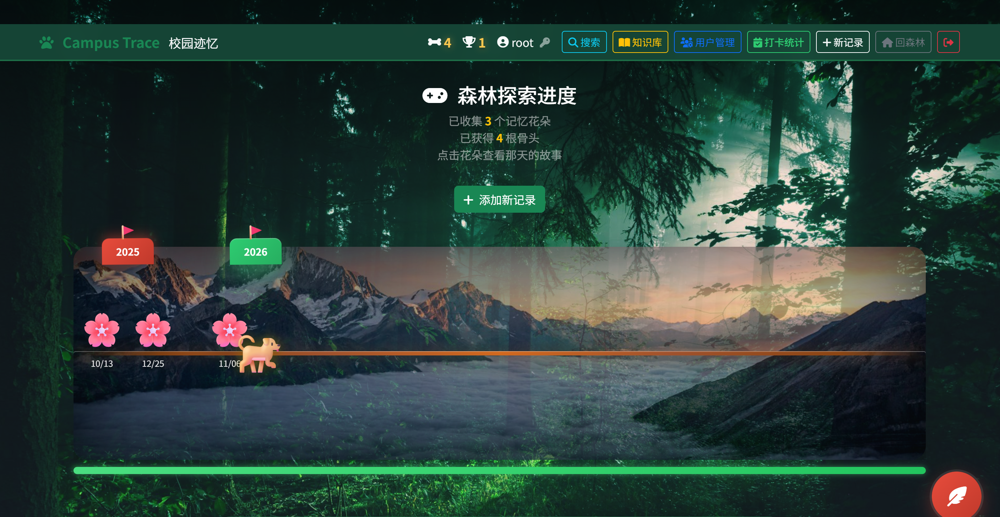
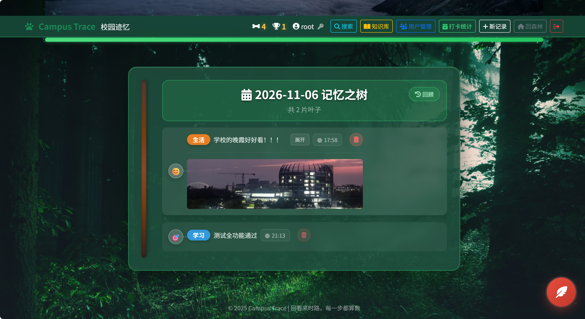
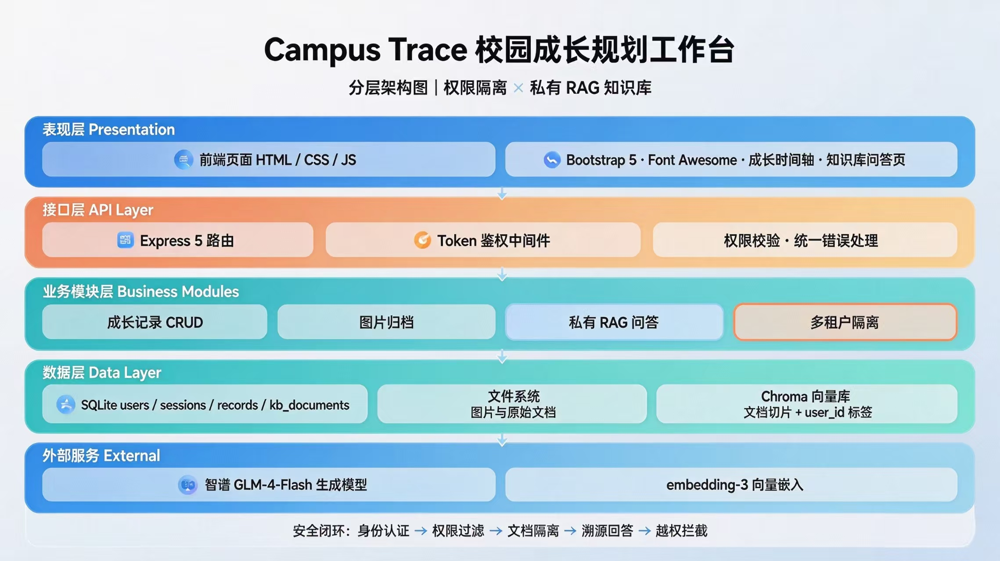

# Campus Trace · 校园迹忆

> 回看来时路，每一步都算数 —— 把零散的日常串成可追溯的成长轨迹

面向大学生的**成长记录 + 情绪管理 + 游戏化激励 + 知识库问答**全栈应用。


---

## 🎯 背景与痛点 <a name="background"></a>

大学生活中，**时间、情绪、成长**三大痛点交织并存：

- **瞎忙无痕迹**：每天感觉很忙，却不知道忙了些什么，零散的努力像没发生过一样
- **情绪无处安放**：焦虑、内耗、孤独是常态，坏情绪越积越多却找不到出口
- **成长感知弱**：努力了很久却感觉不到进步，备忘录、朋友圈、日记本里的记录无法串成成长曲线
- **知识散落难检索**：课件、笔记、论文 PDF 散落在各处，想找知识点只能逐个翻文件
- **AI 问答不可靠**：直接问大模型容易产生幻觉，回答无法溯源到自己的真实材料

> 当前主流工具偏重任务管理，忽视**情绪表达、成长记录与正向激励**。
> Campus Trace 用「森林」隐喻重新定义记录：**对抗瞎忙（时间）、对抗孤独 emo（情绪）、对抗反馈延迟（成长）**。

### 目标用户

- **在校大学生**：希望管理日常、释放情绪、记录成长过程
- **自律困难者**：缺乏动力坚持，需要正向反馈机制
- **独来独往的学生**：缺少倾诉对象，渴望一个安全的情绪容器

---

## 📑 目录 <a name="toc"></a>

- [背景与痛点](#background)
- [核心亮点](#features)
- [技术栈](#tech-stack)
- [系统架构](#architecture)
- [快速开始](#quick-start)
- [环境变量](#env-vars)
- [项目结构](#structure)
- [贡献指南](#contributing)
- [License](#license)
- [联系与致谢](#contact)

---

## ✨ 核心亮点 <a name="features"></a>



### 🌳 森林探索界面
- **时间之路**：将时间线转化为森林探索路径，按日期像素排布，跨年自动留白
- **奔跑小狗**：🐕 作为用户情感化化身，跟随最新记录奔跑，营造陪伴感
- **记忆花朵**：每条记录绽放为一朵花，点击可查看详情，按日期动态布局不重叠
- **年份旗帜**：跨年处自动插入导航旗帜，支持拖动快速跳转

### 📝 智能记录与情绪识别



- **四层分类**：学习 / 生活 / 活动 / 碎碎念，输入时实时推荐，提交时尊重用户选择
- **情绪自动识别**：关键词权重算法推断心情（开心 / 平静 / 难过 / 焦虑 / 专注），学习类自动匹配「专注」
- **里程碑检测**：成就事件自动标记为里程碑，区别于日常记录
- **图文混排**：支持拖拽上传图片，实时预览，长文本智能折叠/展开

### 🎮 游戏化激励
- **骨头计数**：每记录一条 = 1 🦴，即时反馈
- **奖杯里程碑**：每达成一个里程碑 = 1 🏆，成就认可
- **连续打卡**：统计连续记录天数，激励坚持
- **庆祝动画**：达成里程碑时触发 CSS 烟花动画反馈

### 📚 知识库 RAG 问答
- **多格式上传**：TXT / MD / CSV / PDF / DOCX，支持中文文件名
- **递归分块**：段落 → 句子 → 字符切分，可调 chunk / overlap
- **引用溯源**：回答强制标注 `[文档名]`，无依据时固定回复「文档中没有该信息」
- **前置拒答**：最佳切片 L2 距离超阈值直接拒绝，减少无效 LLM 调用

### 💎 交互与视觉体验
- **森林主题色彩系统**：统一 CSS 变量，60+ 精心设计的动画效果
- **毛玻璃质感**：`backdrop-filter: blur()` 营造层次感
- **响应式适配**：Bootstrap 5 网格 + 媒体查询，移动端友好
- **防误删机制**：删除操作二次确认模态框

### 🔐 多租户与权限
- **用户隔离**：记录、文档、向量切片均按 `user_id` 硬过滤
- **管理员后台**：仅 `is_admin` 可见，可级联删除用户（记录 / 文件 / Chroma 切片）
- **修改密码**：验证旧密码，改密后清除其他设备会话

---

## 🛠️ 技术栈 <a name="tech-stack"></a>

| 层级 | 技术 |
| :--- | :--- |
| 后端 | Node.js 24 · Express 5 · better-sqlite3 · multer |
| 向量库 | Chroma（本地运行） |
| LLM / Embedding | 智谱 AI · GLM-4-Flash · embedding-3 |
| 前端 | 原生 HTML / CSS / JS · Bootstrap 5 · Font Awesome |
| 存储 | SQLite · 文件系统 · Chroma |

---

## 🏗️ 系统架构 <a name="architecture"></a>

Campus Trace 采用经典的分层架构，各层职责清晰，RAG 数据流贯穿业务层与数据层，安全设计覆盖全链路。

### 1. 分层架构图



### 2. RAG 数据流

```text
用户提问
   │
   ▼
① 鉴权校验 ─── 确认登录态
   │
   ▼
② 检索 ─── Chroma where: { user_id } 硬过滤（只召回当前用户文档）
   │
   ▼
③ 距离判断 ─── 最佳切片 L2 距离 > 阈值 → 直接拒答，不调用 LLM
   │
   ▼
④ LLM 生成 ─── 召回片段 + 问题 → 强制标注 [文档名]，无依据回复"文档中没有该信息"
   │
   ▼
返回答案 + 引用片段（含文档名、原文、距离分）
```

**多租户隔离**：每个切片 metadata 携带 `user_id` 与 `doc_id`，检索时强制 `where: { user_id }`，用户只能搜到自己的文档。

### 3. 安全设计

- **密码加密**：scrypt 加盐哈希，**不明文存储**
- **会话管理**：Token 存库，7 天过期，改密后清除其他设备会话
- **越权防护**：受保护接口强制鉴权，知识库检索按 `user_id` 隔离
- **权限分级**：管理接口需 `is_admin`，非管理员返回 403
- **级联清理**：删除用户时一并清理数据库记录、上传文件、Chroma 切片
- **幻觉抑制**：Prompt 约束 + 距离阈值前置拒答 + 引用溯源三重保障

---

## 🚀 快速开始 <a name="quick-start"></a>

### 环境要求

- Node.js >= 18
- Python 3（运行 Chroma）

### 步骤

```bash
# 1. 克隆仓库
git clone https://github.com/AngelDai-lab/CampusTrace.git
cd CampusTrace

# 2. 安装依赖
npm install

# 3. 配置环境变量
cp .env.example .env
# 编辑 .env，填入你的智谱 AI API Key

# 4. 启动 Chroma 向量库
pip install chromadb
chroma run --path ./chroma_db

# 5. 启动应用
npm start
```

访问 http://localhost:3000

### 设为管理员

注册账号后，将某用户设为管理员即可使用用户管理：

```sql
UPDATE users SET is_admin = 1 WHERE username = 'your_username';
```

---

## ⚙️ 环境变量

| 变量 | 说明 | 默认值 |
| :--- | :--- | :--- |
| `PORT` | 服务端口 | `3000` |
| `CHROMA_URL` | Chroma 地址 | `http://localhost:8000` |
| `CHROMA_COLLECTION` | Chroma 集合名 | `campus_trace_kb_v2` |
| `LLM_MODEL` | 对话模型 | `GLM-4-Flash` |
| `EMBEDDING_MODEL` | 向量模型 | `embedding-3` |
| `RAG_CHUNK_SIZE` | 单切片字符数 | `500` |
| `RAG_CHUNK_OVERLAP` | 重叠字符数 | `80` |
| `RAG_TOP_K` | 召回切片数 | `5` |
| `RAG_SCORE_THRESHOLD` | 拒答距离阈值 | `1.5` |

> 完整模板见 [.env.example](./.env.example)，复制后填入自己的 Key 即可。

---

## 📁 项目结构

```text
Campus-trace/
├── src/
│   ├── server.js          # Express 入口，路由与中间件
│   ├── db.js              # SQLite 表结构与数据访问
│   └── rag.js             # RAG 流程：解析 / 分块 / 向量化 / 检索 / 生成
├── public/
│   ├── index.html
│   ├── auth.js            # 登录 / 注册 + apiFetch 封装
│   ├── script.js          # 核心前端逻辑
│   ├── style.css
│   ├── images/
│   └── vendor/            # 本地化 Bootstrap / Font Awesome
├── .env.example
├── .gitignore
├── package.json
└── README.md
```

---

## 🤝 贡献指南 <a name="contributing"></a>

我们非常欢迎任何形式的贡献，无论是提交代码、报告 Bug 还是完善文档。

- **寻找任务**：查看 Issues 寻找你感兴趣的问题。

**提交代码**：

1. Fork 本仓库到你的账号。
2. 新建分支：`git checkout -b feature/your-feature`
3. 提交更改：`git commit -m 'feat: add some feature'`
4. 推送到分支：`git push origin feature/your-feature`
5. 新建 Pull Request。

---

## 📜 License <a name="license"></a>

本项目采用 MIT 许可证。你可以自由地使用、修改和分发本项目的代码，只需保留原作者版权声明。

详见 [LICENSE](./LICENSE)。

---

## 🙏 联系与致谢 <a name="contact"></a>

- **作者**：AngelDai-lab
- **项目地址**：https://github.com/AngelDai-lab/CampusTrace

感谢所有使用和关注本项目的人。每一个优秀的项目背后，都离不开社区的反馈与支持。
